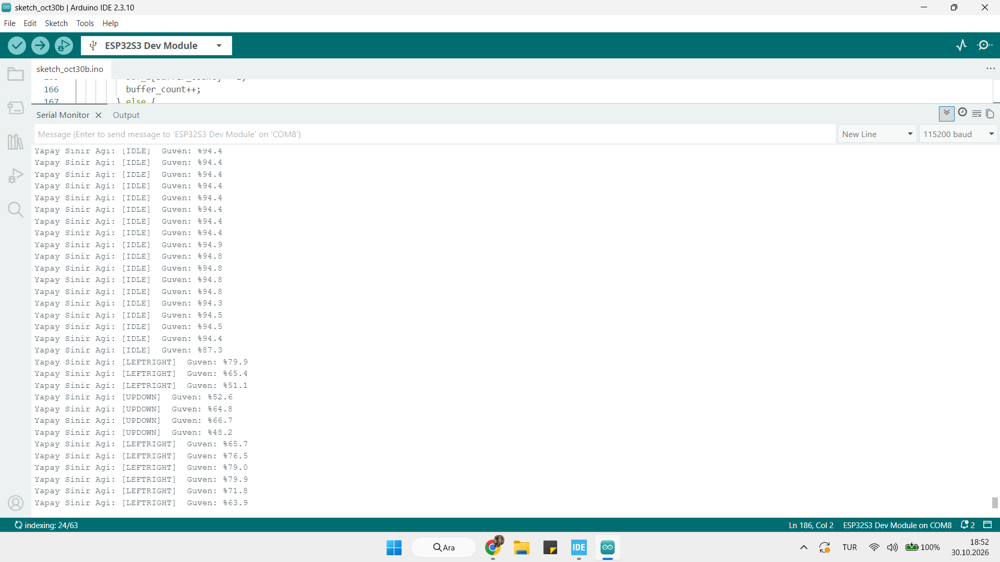

# Edge-AI Gesture Recognition System (STM32F4 + ESP32-S3)

A distributed TinyML system performing real-time hand gesture recognition. The system leverages an **STM32F407-Discovery** board as a bare-metal sensor node and an **ESP32-S3** microcontroller as an on-device inference engine running an embedded Multi-Layer Perceptron (MLP) Neural Network.

---

## 📌 System Architecture

<pre>
[ LIS3DSH Accelerometer ]
          │  SPI (100 Hz, Bare-Metal Driver)
          ▼
[ STM32F407 Sensor Node ]
          │  UART @ 115200 Baud (X, Y, Z raw stream)
          ▼
[ ESP32-S3 Edge-AI Node ]
          ├─ Sliding Window Buffer (50 samples, 10-sample step)
          ├─ Feature Extraction (Mean, Std, Min, Max, Peak-to-Peak)
          ├─ Z-Score Normalization
          └─ MLP Neural Network Inference (8 Hidden, Softmax Output)
</pre>

---

## 🛠 Hardware Setup

| STM32F4 Pin | ESP32-S3 Pin | Function |
|:---:|:---:|:---:|
| `PA2` (TX)  | `GPIO 18` (RX)| UART Data Stream |
| `GND`       | `GND`        | Common Ground |

---

## 🚀 Key Technical Highlights

- **Bare-Metal Drivers:** Register-level peripheral control on STM32F4 (SPI1 & USART2) without heavy HAL/LL library overhead.
- **Embedded Neural Network:** Fully embedded feedforward neural network (MLP) running in pure C++ on the ESP32-S3 without external interpreter dependencies.
- **Sliding Window Inference:** Uses a 50-sample window (~1.0s) evaluated every 10 samples (~200 ms step) to achieve low-latency real-time response.
- **Recognized Classes:**
  - `IDLE` (Stationary state)
  - `LEFTRIGHT` (Horizontal hand gesture)
  - `UPDOWN` (Vertical hand gesture)

---

## 📊 Live Inference Results

The neural network outputs real-time class predictions along with softmax confidence scores directly over the serial interface.

### Model Specifications
- **Input Features (15):** Mean (X, Y, Z), Std (X, Y, Z), Min (X, Y, Z), Max (X, Y, Z), Peak-to-Peak (X, Y, Z)
- **Architecture:** Dense(15 -> 8, ReLU) -> Dense(8 -> 3, Softmax)
- **Inference Latency:** < 1 ms on ESP32-S3 (240 MHz Tensilica Core)
